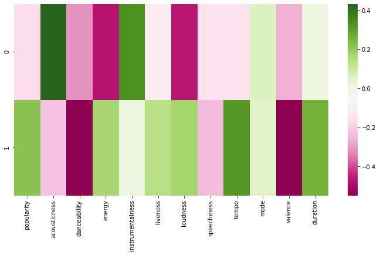

# Spotify Genre Analytics

Collects about 50,000 Spotify tracks across 150+ music genres through the Spotify Web API, enriches each track with audio features (energy, danceability, acousticness, tempo…), and uses PCA to see how genres differ in sound.

Team project from the Data Mining module of my MSc in Data Analytics at Dublin City University.

## Business problem

Streaming platforms and labels group music by genre, but genre labels are messy and subjective. Audio features describe how a song actually *sounds*. A large labelled dataset of tracks plus audio features is the starting point for:

- checking whether genres are really different in sound
- building genre classifiers and playlist recommendations
- spotting tracks that are labelled with one genre but sound like another

## What this repo does

| Notebook | Purpose |
|---|---|
| `01_spotify_api_exploration.ipynb` | Connects to the Spotify API with Spotipy, pulls tracks from a playlist, and tests genre and ISRC search |
| `02_genre_track_extraction.ipynb` | For each genre: searches tracks with `genre:<name>`, follows pagination to fetch all pages, gets audio features, and merges everything into one dataset |
| `03_pca_audio_features.ipynb` | Scales 12 numeric features and runs PCA to find the main patterns in the sound |

### Data collection pipeline

```
Genre list (CSV)
   │
   ├─ Search API: genre:<name>, 50 tracks per page, follow "next" until done
   ├─ Keep track ID, name, popularity, release date, artists
   ├─ Audio Features API: acousticness, danceability, energy, instrumentalness,
   │  liveness, loudness, speechiness, tempo, key, mode, valence, duration
   ├─ Merge on track ID and tag with the genre
   └─ Save per-batch CSVs, then combine into one final dataset
```

## Results

- **50,002 tracks** with 12 numeric audio features
- The first two principal components explain about **39%** of the variation (28.3% and 10.4%)
- **PC1 = "acoustic and calm vs loud and energetic"**: acousticness and instrumentalness on one side, energy and loudness on the other
- **PC2 = "long and fast vs danceable and happy"**: tempo and duration against danceability and valence



## Tech stack

Python · Spotipy (Spotify Web API) · pandas · scikit-learn · matplotlib · seaborn

## How to run

```bash
git clone https://github.com/Omkyao1998/Spotify_Genre_Analytics.git
cd Spotify_Genre_Analytics
pip install -r requirements.txt
```

1. Create an app at the [Spotify Developer Dashboard](https://developer.spotify.com/dashboard) and copy the client ID and secret.
2. Paste them into the credentials cell (never commit real keys).
3. Put a `Genre_List.csv` file with an `id` column of genre names next to the notebooks.
4. Run the notebooks in order.

**Note:** Spotify restricted the Audio Features endpoint for new apps in November 2024, so the feature-extraction step may not work with a newly created app.

## What I would improve next

- Replace the one-cell-per-genre calls with a single loop that saves progress, handles rate limits and retries
- Load credentials from environment variables instead of the notebook
- Drop duplicate tracks that appear in more than one genre
- Train a genre classifier on the features and colour the PCA plot by genre

## Author

**Omkar Gokhale** — Data Engineer & BI Analyst · [GitHub](https://github.com/Omkyao1998)
